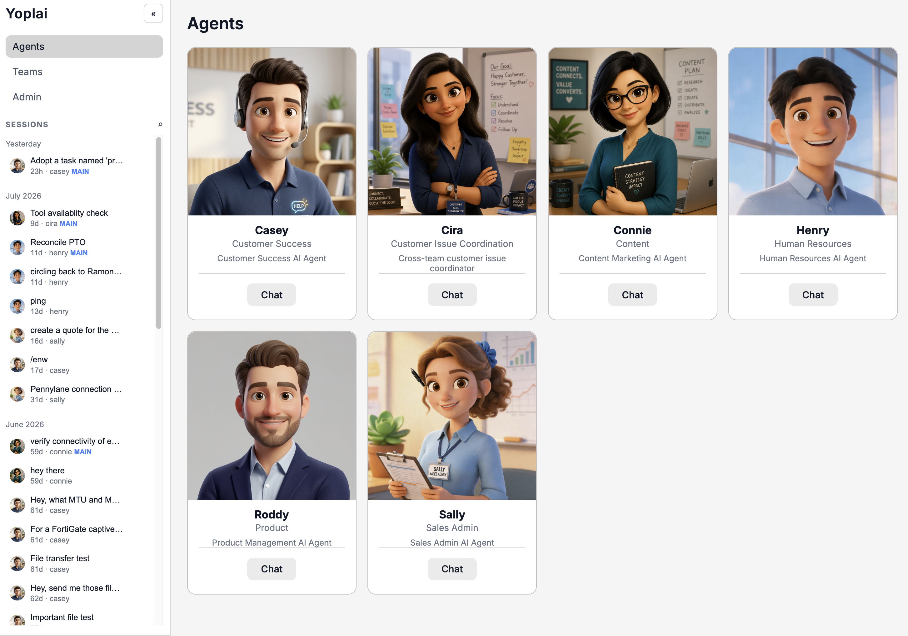

# Yoplai

Self-hosted gateway for running AI agents through a web UI, CLI, messaging channels, scheduled jobs, and project workflows.



Yoplai keeps configuration, conversations, and project data on your machine. Start with one agent locally, then add channels, automation, authentication, or container isolation as needed.

## What you get

- Web chat with streaming, tool calls, files, and session history. Compaction preserves the transcript and adds collapsed summaries in Simple and Full views; use **Load earlier messages** to reach older messages.
- Multiple configurable agents and external CLI subagents
- Opt-in [session model routing](docs/model-routing.md) for Pi chat, with durable model locks, subscription quota selection, shadow rollout and off-mode rollback.
- Optional Discord, Slack, Telegram, Mattermost, IRC, and webhook entry points
- Slack credential refusals offer [one personal connection link](docs/slack-credential-connect.md) for pairing plus Google OAuth, extension tokens, or extension-owned OAuth, with a confirmation in the original thread.
- Slack `!pair` links an existing web account for personal credentials; [setup and email requirements](packages/extensions/slack/README.md#account-pairing).
- Scheduled jobs, project boards, slices, and orchestration
- Private-by-default Canvas dashboards with selected-user or platform-wide read/write sharing, independent of agent/team access. Created and updated dashboards appear in web chat and its side panel. **Chat** on a dashboard or its list row returns creators to the creating conversation, or starts a new chat for other users with agent access. Find owned/shared pages in **Dashboards**, where owners manage access even after leaving an agent. Readers see published HTML; writers see live drafts and publish through an accessible agent. Legacy dashboards remain live and agent-gated until claimed privately. SQLite data and workspace drafts remain shared.
- **Skills**, below Agents in the sidebar, manages private, shared and legacy agent skills. Upload a folder or zip, create through chat, or import from another assistant with a revocable 24-hour token. Enable a skill for your next turn on any agent; other users' turns keep their own selection. Share with people (read/write) or everyone (read), inspect files before enabling, and restore one of ten saved versions. Superadmins inspect all skills, including the always-on system skills, in **Admin → Skills** and can disable/delete platform-wide skills; OpenClaw is unchanged.
- OAuth extension scopes follow root settings and agent overrides; a connection missing required permissions prompts reconnection with those scopes.
- File-based runtime data by default; SQLite only for optional features such as multi-user auth

## Quick start

This guide creates one local agent authenticated with Anthropic OAuth. No Docker, database, messaging app, or public server is required.

### 1. Prerequisites

Install:

- [Git](https://git-scm.com/)
- Node.js **22.19.0 or newer** (24 LTS recommended; sandboxes run Node 24)
- pnpm **11** (`corepack enable` can install the repository-pinned version)
- An Anthropic account for OAuth login

Check versions:

```bash
node --version
pnpm --version
```

### 2. Clone and install

```bash
git clone https://github.com/tobalsan/yoplai.git
cd yoplai
pnpm install
```

### 3. Create the local configuration

Yoplai reads `$YOPLAI_HOME/yoplai.json`. The default home is `~/.yoplai`; setting it explicitly makes later commands predictable.

```bash
export YOPLAI_HOME="$HOME/.yoplai"
mkdir -p "$YOPLAI_HOME/agents/my-agent"

cat > "$YOPLAI_HOME/yoplai.json" <<'JSON'
{
  "version": 3,
  "agents": ["agents/*"],
  "extensions": {},
  "notifications": {
    "adminChannel": "ops",
    "channels": { "ops": { "slack": "C0123456789" } }
  },
  "gateway": { "bind": "loopback", "port": 4000 },
  "ui": { "bind": "loopback", "port": 3000 }
}
JSON
```

`agents` paths are relative to `yoplai.json`. Yoplai does not create this file automatically.

### 4. Configure one agent

Agent folder name and `id` must match:

```bash
cat > "$YOPLAI_HOME/agents/my-agent/agent.yaml" <<'YAML'
id: my-agent
name: My Agent
language: en
auth:
  mode: oauth
model:
  provider: anthropic
  model: claude-sonnet-4-5
YAML
```

Set `language` to `en` (the default) or `fr` to localize fixed messages shown when a run fails. The optional `notifications.adminChannel` points to a named entry under `notifications.channels`; quota failures notify that channel at most once per provider/model per hour. For example, the config above sends to the Slack channel configured as `ops`.

Yoplai creates missing workspace prompt files (`AGENTS.md` and `USER.md`) on first run. You can edit them later to customize agent behavior.

Agents preserve stored OAuth credentials when `auth.mode: oauth` is set or `auth.mode` is omitted (automatic selection), including per-run model overrides and fallback models. Use `auth.mode: api_key` to require an API key instead of stored OAuth for the agent's configured model.

### 5. Build and authenticate

Build before running any `pnpm yoplai` command from a fresh clone:

```bash
pnpm build
pnpm build:web
pnpm yoplai auth login anthropic
pnpm yoplai auth status
```

Follow OAuth instructions printed in terminal. Credentials are stored under `$YOPLAI_HOME`; do not commit that directory. `auth login` only lists OAuth providers (e.g. `anthropic`, `openai-codex`). Every other provider is API-key based and needs no login: set the provider's env var (`<PROVIDER>_API_KEY`, e.g. `OPENCODE_API_KEY` for `opencode-go`, `OPENROUTER_API_KEY` for `openrouter`; see the [provider table](https://pi.dev/docs/latest/providers#api-keys)) in your shell or `$YOPLAI_HOME/.env`, and reference it with `$env:NAME`—never put plaintext secrets in tracked configuration.

If a newly released model is missing from Yoplai's bundled catalog, run `pnpm yoplai models refresh` to update `$YOPLAI_HOME/models-store.json`, then restart the gateway.

### 6. Start Yoplai

```bash
pnpm yoplai gateway
```

Keep terminal open. Then visit:

- Web UI: <http://127.0.0.1:3000>
- Gateway health: <http://127.0.0.1:4000/health>

### 7. Verify installation

In another terminal:

```bash
export YOPLAI_HOME="$HOME/.yoplai"
curl -fsS http://127.0.0.1:4000/health
curl -fsS http://127.0.0.1:4000/api/agents
```

Expected results:

1. Health returns `{"ok":true}`.
2. Agent list contains `my-agent`.
3. Web UI opens and shows **My Agent**.
4. Sending a message produces a model response.

Once foreground startup works, see [Self-hosting](docs/self-hosting.md) for background service and server deployment options.

## Basic customization

Choose a **main agent** on your first home visit: home then opens a fresh chat with that agent, ready for your first message. With only one available agent, this happens automatically. Change your choice from the star button in the chat header or the star on an agent's card on the **Agents** page (with a confirmation); the main agent is listed first and highlighted there, and the chat header's cog opens that agent's settings; all other agents remain available there. The preference is personal and survives logout, browser changes, and gateway restarts in both single-user and multi-user installs. Opening a blank chat creates no saved session until you send a message.

Manage skills from **Skills** below Agents: uploads and imports start private and off, while **Create skill** opens a new chat with your main agent (or an agent picker) and fills in the interview prompt for you to send; the agent saves with `skill_save`. In multi-user mode, a superadmin can mark an agent workspace skill as **System** on **Admin → Skills**. This hides the skill from the **Skills** page. Agents still load it. Operators curate defaults in `$YOPLAI_HOME/skill-library/default/<name>/SKILL.md`, optionally adding `.yoplai.json` with `{ "agents": ["hr"] }`; user content, enable settings, sharing, import-token hashes and the last ten versions live under `skill-library/`. Existing agent workspace `skills/` folders keep loading unchanged and appear read-only; defaults and the `dashboard` and `skill-creator` built-ins are always on and appear only in **Admin → Skills**, and OpenClaw ignores this page in v1. See [Skill sources](docs/models-and-skills.md#skill-sources) for all sources and their load order.

Edit `$YOPLAI_HOME/agents/my-agent/agent.yaml` to change model or agent settings. Edit prompt files in the same folder to define identity and instructions.

Enable optional features in root `extensions`:

```json
{
  "version": 3,
  "agents": ["agents/*"],
  "extensions": {
    "scheduler": { "enabled": true },
    "projects": { "enabled": true, "root": "~/projects" }
  },
  "gateway": { "bind": "loopback", "port": 4000 },
  "ui": { "bind": "loopback", "port": 3000 }
}
```

Agent-specific tool extensions also require an entry in `agent.yaml`. See [Configuration](docs/configuration.md) and [Extensions](docs/extensions.md).

In multi-user mode, add your own extension API token (and, if needed, your own email/subdomain or other settings) on the **Just me** tab of the extension configuration form. Admins of a linked team (and superadmins) can manage **Whole team** credentials; everyone with chat access can edit extensions without secrets or OAuth; existing team tokens remain the fallback. Personal tokens require `oauth.encryptionKey` and stay encrypted on the gateway. See [personal extension tokens](docs/extensions.md#personal-extension-api-tokens).

Use an agent's **My connections** tab to inspect and disconnect your personal connections and see team availability. **Account settings** lets you remove Slack pairings; the next Slack request uses the unpaired flow. Disconnecting affects only your credentials and the next request uses team credentials when available.

Connecting an OAuth extension from settings takes you to the provider in the same tab and returns to the page with a connection result. Pending extension settings are saved before leaving. Chat's **Connect tools** prompt keeps its popup so the conversation stays open.

## Link a remote gateway

Run `yoplai connect https://remote.example.com --name ams` on your local gateway, or open **Link gateway** in the sidebar (page `/remote-gateways`). Your browser opens the remote gateway. Sign in there and approve this computer. Your local gateway then stores its own key, so you copy no token. The agents of the remote gateway show in the agent list as `<agentId>@ams`, with a small `@ams` mark, and you chat with them on the local page. The remote gateway must run in multi-user mode with email or Google sign-in. A remote gateway with no sign-in links at once with no page and no key.

Use `--no-browser` to print the sign-in address and open it yourself. The browser must run on the same computer as the local gateway. The address of the remote must be `https://` and an origin only (no path). Use `--token <user token>` (create one with `yoplai user token create` there) only for an older remote that has no browser sign-in.

A browser link has its own key. It expires after 90 days, and you link again to renew it. A link shows its account, device, key state, and connection state on `/remote-gateways`. `yoplai remotes` lists links. `yoplai disconnect ams` revokes the key on the remote gateway and removes the link. If the remote is offline, the link stays. Use `yoplai disconnect ams --local-only` (or **Remove locally**) to remove it from this computer only. The remote key then stays valid until you revoke it or it expires. You see and revoke your linked devices on the remote gateway at `/account/gateway-links`. If a link attempt ends with "uncertain", revoke the key there first, then link again.

The link works only when the local gateway listens on `127.0.0.1` and multi-user mode and Tailscale serve are off. A gateway bound to another loopback address (such as `::1`) keeps its saved links but cannot start a new browser link.

Configuration transport now supports linked gateways through an explicit API prefix and an allowlist.
The linked bearer defines the remote requester, including personal connections and administrative rights.
Remote OAuth starts use a trusted-origin JSON POST and return a checked provider URL.
The remote stores state and tokens. The local server never fetches the provider URL.
Settings pages of a remote agent (extensions, MCP servers, connections, schedules, webhooks, dashboards, teams) work on the local page. Open them from the settings link of the chat, or at `/agents/<agentId>@<name>/edit`. Open the dashboards of one remote gateway at `/dashboards?gateway=<name>`. A sign-in for a remote agent opens in a popup that your browser must allow, and the page confirms it from the remote status. The remote gateway decides every permission. Remote dashboards open on the local page at `/remote-dashboards/<gateway>/<id>`, and in a chat panel for a remote agent. The page shows a dashboard through a trusted shell, and Chat and annotation follow the access that the remote gateway reports.

Core OAuth starts need the new JSON start result on the remote gateway.
A desktop does not need the remote provider extension or scheduler extension to forward these requests.
Media and agent lists permit only bounded redirects within the same gateway and route family.

See [remote configuration transport](docs/relay-configuration.md) for the API and page contract.


### Let a remote agent use your machine

While your local gateway runs and is linked, an agent on the remote gateway can read, write, and edit files and run commands on your machine. It uses the tools `device_read`, `device_write`, `device_edit`, and `device_bash`. Your local gateway decides for each call. Each chat has one of three modes:

| Mode | When | Read | Write and edit | Command |
|---|---|---|---|---|
| Ask | Default | Passes | Asks you | Asks you |
| Workspace | The chat has a workspace folder | Passes | Passes inside the folder, asks outside | Asks you |
| Full | You switch it on | Passes | Passes | Passes |

A relative path and each command start in the workspace folder. With no folder, they start in your home directory. A run with no person present, such as a scheduled job, gets a refusal for each call that asks. You can allow all calls of one remote agent for such runs. In a chat with a remote agent, a call that needs approval shows as a card with the buttons Approve and Refuse. The control in the chat header shows the mode as "Device: Ask", "Device: Workspace", or "Device: Full". Its panel sets the workspace folder and the Full switch, and has a switch that allows all calls of that agent for scheduled jobs. You can set the folder before the first message of a new chat.

Secret files: a read of a common secret file gets a refusal with no prompt, in Ask and Workspace mode and in a run with no person present. A write or edit of such a file always asks, also inside the workspace folder. Full access bypasses these rules. The list covers these paths and names, in upper and lower case:

- Folders at any depth: `.ssh`, `.gnupg`, `.aws`, `.azure`, `.kube`, `.password-store`, `.config/gcloud`, `Library/Keychains`.
- The file `.docker/config.json`.
- File names: `.env` and `.env.<x>` (not `.env.example`, `.env.sample`, `.env.template`, `.env.dist`), `.netrc`, `.npmrc`, `.pypirc`, `.git-credentials`, `.htpasswd`, `auth.json`, `credentials`, `credentials.json`, and names that start with `id_rsa`, `id_dsa`, `id_ecdsa`, or `id_ed25519`.
- File types: `.pem`, `.key`, `.p12`, `.pfx`, `.keychain-db`, `.kdbx`.
- In the Yoplai home: `remote-gateways.json`, `device-settings.json`, `user-token.json`, `auth.db`.

Limits: the rules match names and real paths. A hard link to a secret file, a copy with a different name, and a file that a local process swaps during a call are not covered. `device_bash` is not covered. If Yoplai cannot find the real path of a file, it refuses the read.

The check also covers the real path behind a symbolic link. A command (`device_bash`) is not checked against this list. It asks in Ask and Workspace mode, so you see the command first. The card shows the whole command. A command over 20,000 characters that needs approval gets a refusal. The agent must write it to a script file and run the file.

How your gateway picks the chat: your local gateway names the chat that you use (the session ID of the page, or its session key) and gives each message that it forwards a secret token for that one turn. The remote gateway sends the token back with each device call of that turn. A call with no valid token counts as a background call. The remote gateway cannot pick the chat or the mode of a call. The link protocol is version 2, so your local and remote gateways must both run this version. One limit: during a turn in a Full chat, the remote gateway controls the agent, so Full means trust in that gateway for that turn. The switch that allows all calls of an agent for scheduled jobs means trust in its gateway for background runs.

Queued remote messages keep their own device permissions, also when two views use the same remote session. A remote reset uses a fresh chat key and starts in Ask mode, with no workspace folder. A remote reset removes the old history query before the send. Reload keeps the fresh chat key and restores its pending approvals. The reset keeps the current view, other query fields, hash, and route state. It transfers no folder, permissions, or history.

The relay allows 20 live send sockets per page socket and 1,000 token records across the local gateway. Token expiry removes device authorization but leaves the stream open. The token limit does not bound all live upstream sockets. This fix adds no global socket limit.

Scheduled jobs: a job gets the device tools only when its config has `requiresDevice: true` (set it in the `requiresDevice` field of `scheduler.create_job` or `scheduler.update_job`). A job with this flag stops at once, with the error code `device_offline`, when your device is not connected. You cannot combine the flag with `noAgent`. On a multi-user gateway, the job needs the credential mode `owner`.

## Troubleshooting

### `yoplai.json` not found

Confirm `YOPLAI_HOME` is exported in the terminal running gateway and that `$YOPLAI_HOME/yoplai.json` exists.

### Agent missing or invalid

Confirm `$YOPLAI_HOME/agents/my-agent/agent.yaml` exists and its `id` matches folder name. Check gateway terminal for validation errors.

### Authentication or provider error

Run `pnpm yoplai auth status`. Re-run `pnpm yoplai auth login anthropic` if needed, then restart gateway.

### `dist` or CLI module not found

Run `pnpm build && pnpm build:web` before `pnpm yoplai ...`.

### Port already in use

Change `gateway.port` and `ui.port` in `yoplai.json`, then use those ports for health and browser checks.

### Docker error

Docker is needed only for agents with `sandbox.enabled: true`. Remove that setting for basic setup or follow [Container isolation](docs/container-isolation.md).

## Documentation

Start with the [documentation index](docs/README.md).

Enable `enableCronMonitoring` to see running jobs and elapsed time in the automatically refreshing Scheduled jobs tab, browse run history, follow live traces,
and open finished traces at the final output; see [scheduler run monitoring](packages/extensions/scheduler/README.md#run-monitoring-experimental).

- [Configuration](docs/configuration.md) — root config, agents, environment, network, UI
- [Session model routing](docs/model-routing.md) — quota ownership, rollout, rollback and shadow reports
- [Self-hosting](docs/self-hosting.md) — services, remote access, upgrades, backups
- [Extensions](docs/extensions.md) — optional feature catalog and enablement
- [Webhooks](docs/webhooks.md) — HTTP-triggered agent runs
- [Container isolation](docs/container-isolation.md) — Docker sandboxing and OneCLI
- [Web UI](docs/web-ui.md) — routes and product workflows
- [CLI](docs/cli.md) and [API](docs/api.md)
- [Projects](docs/projects.md), [Scheduling](docs/scheduling.md), and [Channels](docs/channels.md)
- [OAuth](docs/oauth.md) and [OpenClaw](docs/openclaw.md)
- Google tool connections support **Just me** (your signed-in web requests) or **Whole team** (shared fallback); existing connections remain shared. See [connection scopes](docs/oauth.md#extension-oauth-connections).
- [Models and skills](docs/models-and-skills.md)
- [Development](docs/development.md) and [data layout](docs/data-layout.md)

For coding-agent architecture and ownership, see [`docs/llms.md`](docs/llms.md).

Personal chat projects support reusable instructions and files on the project page. Upload documents or images, view the file list, and delete files there; agents receive small extracted documents directly and can read larger originals from the project files directory (read-only `/project-files` in sandboxes). Uploads have a 25MB limit; extraction failures retain the original file and show a reason. PDFs with a text layer have no page-count limit; extraction remains capped at 250,000 characters. OCR reads the first 30 scanned pages, with a neutral partial-text note when more are skipped. Chat and project uploads accept JSON and PowerPoint (`.pptx`, `.ppt`), alongside Markdown, text, CSV, PDF, Word, Excel and images.

Files an agent sends in a project chat are saved to the project automatically, using the same upload limits and text extraction. Re-sending identical bytes with the same name deduplicates agent-added files across conversations; different content keeps a separate suffixed name. The tool reports whether the file was added, already present, or rejected by the project; chat delivery succeeds even when the project add fails.

Agents can download and edit files in a writable folder scoped to the conversation and requester (`/workspace/files` in sandboxes). Extensions receive its host and runtime paths through `context.conversationFiles`; `send_file` shares a finished regular file anywhere in that folder, including sub-folders, as a downloadable chat card named after the file's basename. With an apps origin, web chat also displays HTML reports, sanitized Markdown, images (SVG included), text, JSON and CSV in the built-in file viewer; `title` is optional (200 characters maximum). HTML reports allow CDN scripts/fonts but cannot make API connections. Other formats and files over 10 MB show a file card. Without a view, new PNG, JPEG, GIF and WebP outputs retain their inline previews and lightbox. Paths escaping the folder and symlinked directories or files are rejected. In multi-user mode these new output downloads are restricted to their requester. Local agents still run with the gateway's host filesystem permissions; use a sandbox for filesystem isolation.
